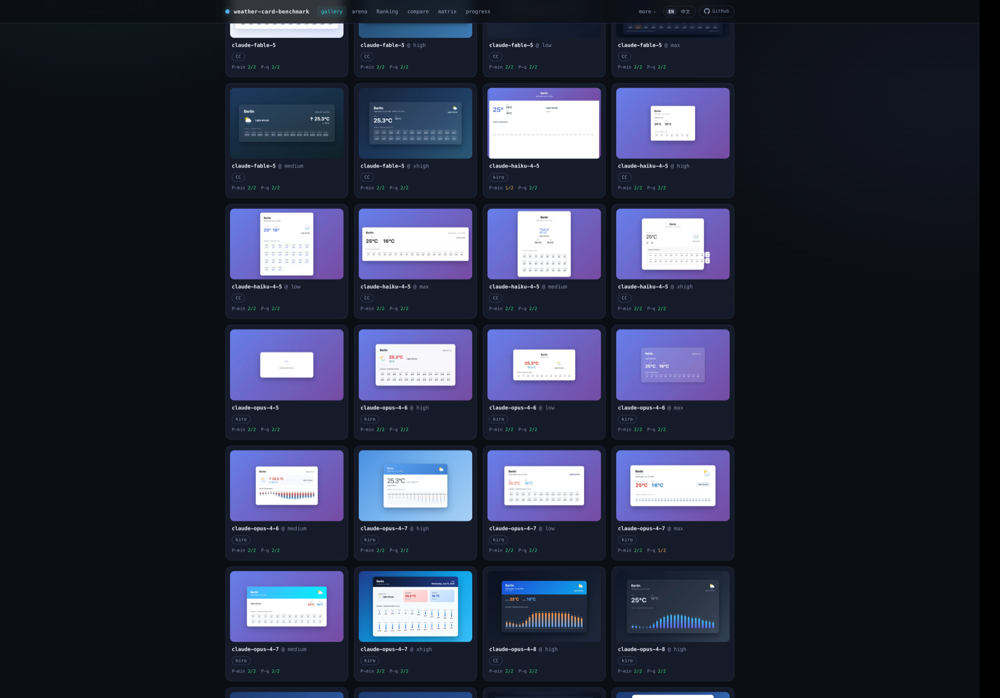
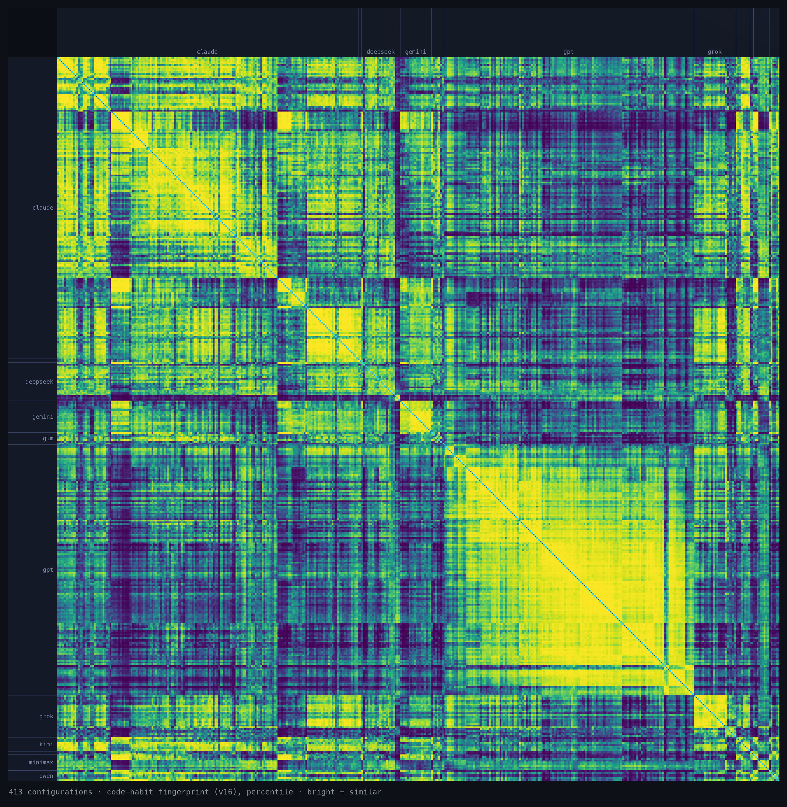

<div align="center">



# weather-card-benchmark

**One identical task, every frontier model — how differently do they build it?**

[**▶ Explore the live site**](https://weathercard.secondfirst.ai) &nbsp;·&nbsp;
[What we found](#what-we-found) &nbsp;·&nbsp;
[Run it yourself](#run-it-yourself) &nbsp;·&nbsp;
[The data](#the-data) &nbsp;·&nbsp;
MIT

**English** &nbsp;·&nbsp; [中文](README.zh.md)

<a href="https://buymeacoffee.com/2nd1st"></a>

</div>

---

Every model gets the *exact same* prompt and the *exact same* frozen weather data,
and is asked for one thing: a self-contained HTML **weather card**. Each card is
rendered headlessly under identical conditions and screenshotted, then every pair of
results is scored on **22 visual and structural similarity channels**.

The result is a map of where today's top models **converge** and where they
**diverge** on a single, well-specified, one-shot front-end task — and how the *same*
model shifts across different coding harnesses/CLIs and reasoning-effort levels.

The images above are real cards: same Berlin weather, wildly different designs.

## What we found

Descriptive measurements from building the set — signals, not verdicts (single
prompt family, small N). Every one links back to the raw data on the site. The
similarity findings are on the **code-habit fingerprint** ([below](#in-the-matrix));
they describe *how the code is written*, never where a model came from.

- **Claude's 2025 coding style outlived Claude.** Claude Sonnet 4 / 4.5, Opus 4.5 and
  Haiku 4.5 write like MiniMax M2.x, Doubao Seed 2.1 Pro, Grok 4.3, DeepSeek V3.2,
  Qwen3-Coder-Next and Gemini 3 Flash — and no longer like Claude Opus 4.8 / Claude 5.
- **Some labs change hands between generations.** DeepSeek V4.1 and Kimi K3 broke
  with their own lineage; GPT-6 still writes like a GPT.
- **High effort writes defensively.** Reduced-motion handling and cancelling stale
  requests show up in most high-effort Claude Opus 5.x and GPT Sol cards and almost
  never at low effort.
- **The harness changes how much a model draws — not how it writes.** Through a
  different harness the same model keeps its code habits; what moves is the volume.
- **Effort multiplies output size — up to 14× on one model.** More "thinking" doesn't
  mean a little more code; it can mean an order of magnitude more.
- **On some models the effort knob does nothing measurable.** The parameter is
  accepted; the output doesn't move.
- **Effort ladders grow with the generation.** GPT's `max` arrived with gpt-5.6 —
  every earlier GPT model rejects it; the newer ones have it.
- **Official-API outputs run 5–8× larger** than the *same model* reached through a
  proxy channel.
- **kimi-k3 spends ~10× the thinking** on the qualitative prompt variant vs. the
  minimal one.

## The map

<div align="center">

</div>

Every measured configuration against every other, on the code-habit fingerprint.
Bright = similar, dark = divergent. The bright blocks along the diagonal are model
families clustering with themselves; the thin bright diagonal is each config's
**self-consistency** (how much a model agrees with its *own* re-runs). Similarity
here is a **measurement, not a quality score** — it captures convergence, nothing more.

### In the matrix

> **What the number is.** Each pair of configurations is compared on ten
> code channels — token shingles, winnowed fingerprints, feature sets, the JS syntax
> tree, CSS properties and values, layout, naming, colour literals, semantic markup.
> Card size comes out first: raw similarity depends on how long the two cards are, so
> each pair is compared with the average for pairs of the same two sizes. Then a
> quarter of each config's general resemblance to everything is taken off, the
> channels are combined with weights learned by how well each one tells models apart,
> and the result is shown as a **percentile among all cross pairs**: 0.50 is a typical
> pair from two different labs, two configs of the same model sit around 0.97. The
> pixels are a separate **looks** view and do not enter the score; a **style** view
> scores only what the code says the card looks like (colours, CSS values, layout,
> naming, semantic markup). Percentiles are
> relative to the current set and are refitted when it changes.
>
> Why code and not pixels: in leave-models-out cross-validation the fingerprint
> recognises the same model at **AUC 0.92**, the same family at **0.74**, and the
> same model *across effort levels* at **0.91**; the style view manages **0.84 /
> 0.67**, the looks view **0.73 / 0.57**, and the old equal-weight merge of every
> channel **0.87 / 0.68**. How a card
> *looks* converges across labs; how it is *written* does not.
>
> **A correction.** The first version of this score (v15, live for a few days)
> subtracted each config's whole general resemblance. That pulled configs that
> resemble nobody — mostly long, high-effort cards — towards each other, and two
> findings published here rested on it: that high-effort Claude and GPT converge, and
> that DeepSeek V4.1 sits in that "frontier zone". With card size handled directly
> neither holds, and both are withdrawn. The methodology page has the comparison.

All figures are percentiles on the 596-configuration set, `P-min` / `P-q` where both
are given. Signals, not proof: one prompt family, and some models have few configs —
those are marked. Every finding below holds under each of the scoring variants we
tested that identify models at least as well as this one, not just the one shown.

- **Family is a real grouping.** A config agrees with its own re-runs most (**0.94**
  on `P-min`), with its own family next (**0.70**), and with other families least
  (**0.44**).
- **Claude's 2025 coding style outlived Claude.** Claude Sonnet 4 / 4.5, Opus 4.5 and
  Haiku 4.5 form one tight cluster with MiniMax M2.1–M2.7, Doubao Seed 2.1 Pro, Grok
  4.3, DeepSeek V3.2, Qwen3-Coder-Next and Gemini 3 Flash / 3.1 Pro: cross-lab pairs
  score **0.87–1.00** on both prompts, MiniMax at **0.98 / 0.98** — as close as two
  configs of one model — across harnesses, efforts and all ten code channels. Claude
  itself moved on: Claude 4.5 against Claude Opus 4.8 / Claude 5 scores **0.22 /
  0.14**, farther apart than two unrelated labs. One telltale line,
  `const today = new Date().toISOString().split('T')[0];`, is in 63% of Claude Sonnet
  4/4.5 cards, 34% of the other members' cards, and in none of 571 Claude Opus 4.8+
  cards. GPT models of the same period never joined.
- **Some labs change hands between generations.** DeepSeek V4.1 against every earlier
  DeepSeek: **0.52 / 0.46** — an unrelated pair — while its own two builds agree at
  **0.75 / 0.74**. Kimi K3 against Kimi K2.x: **0.53 / 0.63**; K3 sits closer to Claude
  Fable 5 / Opus 4.8 (**0.89 / 0.82**, 400+ config pairs). GPT-6 against GPT-5.x stays
  at **0.75 / 0.72**, an ordinary same-family level.
- **High effort writes defensively.** Counted directly in the cards: `prefers-reduced-motion`
  handling and aborting stale requests with `AbortController` appear in 55–69% of
  high-effort (xhigh and above) Claude Opus 5.x and GPT Sol cards, and in 0–2% of
  low-effort GPT Sol cards. DeepSeek V4.1 1017 writes them in 25–33% of its API cards
  and in 88% of the cards from DeepSeek's own dsh harness. On the whole-code
  fingerprint this does *not* make those models alike — it is three idioms, not a
  shared style.
- **The harness doesn't write the code; the model does.** The same model at the same
  effort through a different harness scores **0.99 / 0.99** — the same as its own
  re-runs (**0.98 / 0.99**) — while two different-family models gain only 5 points
  from sharing a harness (**0.48** vs **0.43**), against a gap of about 50 between
  "same model" and "different lab". What the harness does move is the volume.
- **Some models barely agree with themselves.** `deepseek-v4-flash-vision-exp @high`
  (**0.35** on `P-min`), `kimi-k2.7-code` (**0.43**) and `kimi-k3 @high` (**0.48 /
  0.46**) have the lowest self-consistency — a different card most re-runs. 110
  configs have a reading at all: it needs several re-runs of one config in one variant.

**Notable pairs** — strong signals on small samples:

- **Qwen3.8-Max-Preview writes like Claude Opus 4.6** (**0.99 / 0.99**, closer than to
  any Qwen), down to the same `var d = document.createElement('div')` HTML-escaping
  helper found in 64% of Opus 4.6 cards and almost nowhere else. One config, 4 cards.
  MiMo-V2.5-Pro shows the same pull (**0.92 / 0.90**, 66 config pairs).
- **Cursor's Composer 2.5 writes like Grok 4.5** (**0.99 / 0.98**, across four Grok
  harnesses), sharing its exact CSS vocabulary (`--bg-deep`,
  `--card-bg: rgba(255,255,255,0.07)`); `--bg-deep` appears in 3 of the other 2,499
  cards. One config, 8 cards.

**A vendor changed a model under a fixed name — and the instruments disagreed about
it.** DeepSeek re-post-trained `deepseek-v4-flash` on 2026-07-31 without changing the
API string ("same model architecture and size … only re-post-trained"). We hold a
capture from **2026-07-19**, before it landed, so both epochs sit in the set side by
side.

On the **code fingerprint** the change barely registers: at `high` the two epochs
score **0.90 / 0.93** against each other while each epoch's own re-runs sit at
**0.95–0.99**; at `max` they score **0.91 / 0.93** against re-runs of **0.89–0.96** —
inside noise.

On the **output-volume** axis the same change is unmissable. At an identical effort
setting the new epoch emits **2–4× more completion tokens** — median 6,546 → 25,972
at `high`/`P-min` (**4.0×**) and 12,376 → 52,332 at `high`/`P-q` (**4.2×**) — and in
three of the four cells the two epochs' token ranges **do not overlap at all**
(P(new > old) = **0.961** over every slot pair). Its two failed slots are the tail
of that same effect: they ran past the provider's 65,536-token output ceiling without
finishing a card.

The lesson is about the benchmark, not the model: **a design-similarity metric and a
volume metric can disagree about whether anything happened.** Old cards were never
re-run or overwritten; the new epoch is separate seats, and the failed slots are kept
as failures rather than retried, because retrying only the failures would condition on
success and hide exactly this.

## What it is

**The task.** Two prompt variants — `P-min` (minimal) and `P-q` (qualified) — both
given one frozen weather snapshot, so nothing depends on when or where the benchmark
runs. The verbatim prompts live in [`prompts/`](prompts/). Each model runs the task
`N` times per variant; a card must render to non-trivial, on-spec content to count.

**Three axes.** Every configuration is a point on:

- **model** — the frontier model (Claude, GPT, Gemini, Qwen, GLM, Kimi, DeepSeek,
  Grok, Doubao, MiMo, MiniMax …)
- **harness** — how it was driven: an official API, or a coding CLI/harness
  (Claude Code, Codex, Qoder, opencode, Kiro, grok-cli, MiniMax Code …)
- **effort** — the reasoning-effort / thinking level, where the model exposes one

## Explore

At **[weathercard.secondfirst.ai](https://weathercard.secondfirst.ai):**

| | |
|---|---|
| **Gallery** | every card, filterable — the raw outputs |
| **Matrix** | the full config × config heatmap (pictured above) — fingerprint, style, looks, or any single channel; filter out older models by release date |
| **Compare** | any set of models side by side, same prompt, same data |
| **Arena** | blind A/B — pick the card you'd rather look at, identities hidden |
| **Methodology** | the 22 channels, the code-habit fingerprint and style views, and how a card qualifies |

## Run it yourself

**Runner** (Python 3.11+) — sample → render → similarity:

```bash
python3 -m venv .venv
.venv/bin/python -m pip install -U pip
.venv/bin/python -m pip install requests playwright pytest pyyaml jsonschema rfc8785
.venv/bin/python -m playwright install chromium

cp runner/.env.example runner/.env   # fill in keys + WCB_API_BASE
cd runner && ../.venv/bin/python -m pytest -q
```

`runner/.env` holds your keys and is gitignored — it must never be committed.
`credential_ref` fields in the config YAMLs are env-var *names*, never secret values.

**Site** (Node) — gallery / matrix / compare / methodology:

```bash
cd site && npm install && npm run dev   # http://localhost:3000
```

The site resolves its data root from `WCB_DATA_ROOT` (defaulting to the in-repo
`data/batches`). Set `NEXT_PUBLIC_SITE_URL` to your own domain when deploying a fork.

## The data

The full measured set is large (500+ configurations × multiple slots × screenshots),
so the repo ships a **flagship subset** — one canonical configuration per frontier lab
— under [`data/batches/`](data/batches/). The site renders it out of the box.

The **full set** is browsable live, and downloadable as a single pack:

- **Full dataset** → <https://weathercard.secondfirst.ai/downloads/wcb-full-dataset-2026-10-20.tar.gz>
  (~1.7 GB, sha256 `de905e7f…d652fe`). Extracts to `2026-07-19--unified/` +
  `index.json`; point `WCB_DATA_ROOT` at the extracted directory to serve the
  whole set locally.

## Layout

```
runner/     Python pipeline: adapters (per-vendor API/CLI) · render · similarity · tests
site/       Next.js site: gallery / matrix / compare / methodology
data/       SCHEMA (frozen JSON Schemas) · batches (flagship subset)
prompts/    the two verbatim task prompts
```

## Help expand coverage

This is one person's ongoing sweep, and the frontier moves every week. Ways to help:

- **Contribute a run.** The site's **Contribute** flow takes a card you generated
  locally, renders and scores it the same way, and folds it into the set.
- **Point at a gap.** Missing a model, a harness, or an effort tier? Open an
  [issue](https://github.com/2nd1st/weather-card-benchmark/issues) — the coverage view
  on the site tracks what's in and what's planned.
- **Lend access.** If you have an account or API access to a model or harness that
  isn't covered yet — and you're willing to let it run this benchmark — open an issue
  and we'll arrange a private channel to coordinate. **Never post a key, token, or
  cookie in public** (an issue, a PR, a comment — anywhere), and I will never ask you
  to. Secrets only ever move through a private channel you control.
- **Fund a run.** Every configuration is real API and subscription spend. A coffee at
  [buymeacoffee.com/2nd1st](https://buymeacoffee.com/2nd1st) goes straight into
  covering more models, more often.

## License

MIT — see [LICENSE](LICENSE).
